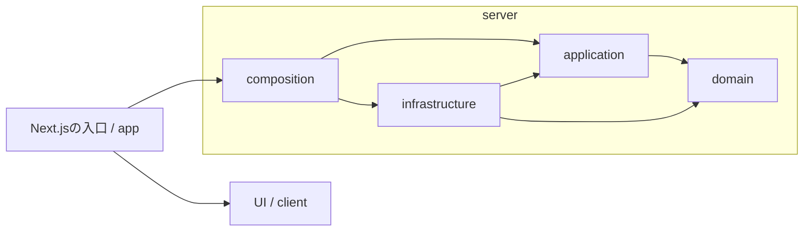

# 開発基盤のアーキテクチャ

## 今回の境界

WebはNext.jsのコンテナ、Firestoreのイベント処理はFirebase Functions、AIワーカーはPythonの実行単位に分ける。Webはルートのnpm workspaceを使う。Firebaseがソースディレクトリ単位で配布する `apps/functions` は同ディレクトリにnpm lockfileを持つ。Pythonは従来どおりuvで管理する。

WebはGoogleログイン、部屋の作成と入退室、デザインプレビュー、liveness、運用者向けの疎通APIを提供する。入退室の状態遷移はWebのdomain、Firestoreへの保存はinfrastructureが扱う。Agentは設定確認CLIを持つ。FirebaseやLiveKitのダミー実装を本番の代わりに置かない。

運用者の音声テスト画面では、Pythonのワーカーが検証室の一発話を処理する。[音声テスト](voice-probe.md)

会員用の通話では、Webが参加状態を確認して部屋限定のLiveKitトークンを発行する。ブラウザはマイクと本人がオンにしたカメラ映像を同室に配信し、会員用ワーカーは文字起こしに同意して入室した全員のマイクを購読し、通常会話の発話区間もGoogle STTに送る。発話の長さに応じてSTT料金が発生する。「AIに話す」の依頼者をLiveKitの送信者IDで識別し、直近の会話は部屋のワーカーメモリに保持する。進行状況はサービスアカウントのGoogle IDトークンでWebの内部APIから取得する。ワーカーは同じ認証で進行案を提案し、討議パートにメモを追記する。返答の音声・字幕を同じ部屋に配信し、字幕はFirestoreに保存しない。[通話の操作と権限](voice-probe.md#会員の部屋で2人とaiが話す)

Agentは録音の `voice-check` と、ローカルのマイク検証用の `live-check` も提供する。計測手順はdomain/application、WebSocketサーバーはinfrastructureに置く。[Agent README](../apps/agent/README.md#声の計測voice-check)

新しい疎通APIはFirestoreに検証データを書き、Functionが作成イベントに応じて記録した値を照合する。SQL Connectの疎通APIも独立して実行できる。

Webの`src`は`app`・`client`・`server`に分ける。`app`はNext.jsの入口、`client`はUIとブラウザ向け処理、`server`はサーバー側の業務・基盤を置く場所とする。Pythonのディレクトリ構成は変更しない。

部屋の進め方（パートの並び）、今のパート、その終了予定時刻はWebサーバーだけが確定する。進め方の確定・変更、切り替え、延長の条件は `server/domain`、現在の状態を確認して更新する手順は `server/application` に置く。PythonのAIワーカーは進め方の案やパートの切り替えをWebへ提案し、部屋の音声から挙手・中断を判断する。発話の開始には、参加者の「AIに話す」か、挙手に対する「どうぞ」が必要になる。延長と提案が重なった場合の処理は[技術選定](technical-selection.md)に記す。

## 依存は業務ルールへ向ける

矢印は主なimportの方向。実行時の通信順序ではない。Pythonでは従来どおり`__main__`が入口、`bootstrap`が組み立てを担当する。

| Webのディレクトリ       | 置くもの                                             | 参照してよい自分のアプリのコード                         |
| ----------------------- | ---------------------------------------------------- | -------------------------------------------------------- |
| `app`                   | ページ・レイアウト・Route Handler。入力と出力の変換  | app・client・serverのcomposition/application/domain      |
| `client`                | UIコンポーネント、ブラウザ向け処理、表示用の型       | clientだけ                                               |
| `server/domain`         | 業務上の型、不変条件、純粋な計算                     | server/domainだけ                                        |
| `server/application`    | 一つの操作の手順、その操作が必要とするI/Oのinterface | server/application・server/domain                        |
| `server/infrastructure` | I/O契約の実装、環境設定、ログ                        | server/infrastructure・server/application・server/domain |
| `server/composition`    | 設定を読み、具体的な実装をユースケースへ渡す         | server内の各層                                           |

`client`から`server`への参照は型だけのimportも禁止する。`server`から`client`や`app`にも依存させない。`app`から`server/infrastructure`を直接参照せず、具体的な実装の生成はcompositionに集める。UIに必要な値は入口で表示用のpropsへ変換し、サーバーの業務型やSDKの型をUIへ持ち込まない。

domainにはNext.js・環境変数・外部SDK、applicationにはHTTP Response・SQL Connectの生成型・SDK初期化を置かない。外部I/O用の型はapplication側に定義し、infrastructureがそれを満たす。Pythonも同じ責務分離を保ち、interfaceに相当する契約には必要に応じてProtocolを使う。

Webではdependency-cruiser、Pythonではimport-linterが依存方向を検証する。Webの型だけのimportも対象とし、別名パス`@/`で境界を迂回できない。`src/instrumentation.ts`はNext.jsの起動入口として`server/composition`を呼ぶ例外であり、UIや業務ロジックを置く場所ではない。

すべてをクラスにする必要はない。まず普通の関数と引数による依存注入を使う。実際に差し替えるI/Oが生まれてからinterfaceを追加する。フォルダーを埋めるための `BaseUseCase` や `BaseRepository` は作らない。

## UIの置き場所と描画方式

`client`は責務を示す名前であり、その中のファイルが自動でClient Componentになるわけではない。静的な表示には`"use client"`を付けず、サーバーで描画する。トップ画面は`client/components/landing.tsx`に置き、`app/page.tsx`から描画する。ログイン操作のClient Componentからブラウザ用Firebase SDKを呼ぶ。`PUT /api/auth/me` はサーバーがFirebaseのIDトークンを検証し、Googleログインした利用者の `users/{uid}` をFirestoreに初回だけ作成する。UIDと初期表示名は検証済みトークンから取得する。

イベントハンドラー、状態管理、ブラウザAPIが必要なコンポーネントの入口にだけ`"use client"`を付ける。UIを移動したことを理由に、ページ全体をClient Componentへ変えない。サーバーの結線には`server-only`も使い、フォルダーのルールとNext.jsのビルド時チェックを併用する。

## 機能を追加するとき

1. 受け入れ条件を書く。成功時、権限がない場合、外部サービスが失敗した場合の振る舞いを決める。
2. Webでは`server/domain`・`server/application`に純粋なルールと操作を置く。外部通信を必要とする箇所だけ契約を定義する。
3. 契約に対して単体テストを作り、外部I/Oはテスト用の実装に差し替える。
4. `server/infrastructure`に実際のSDKアダプターを追加し、結合テストで接続・認証・権限を確かめる。
5. `server/composition`で結線する。表示は`client`、Next.jsの薄いページ・HTTP入口は`app`へ追加する。Pythonでは従来どおり各層とbootstrapを使う。
6. 必要な環境変数、失敗時のログ、その機能に適用される外部サービスの制限とタイムアウト、運用手順を更新する。

将来ファイル数が増えたら、各層の中を `rooms/` や `lessons/` など実際の機能単位に分ける。今はまだ機能名の空フォルダーを増やさない。

## 設定とログ

外部サービスのSDKはimportしただけでは初期化しない。ビルドと単体テストが認証情報に依存しない状態を維持する。サーバー用の設定をブラウザへ渡さず、`NEXT_PUBLIC_` は公開してよい値に限定する。

Node.jsの起動時は`instrumentation`から`initializeServerRuntime`を呼び、設定検証と`runtime.started`の出力を行う。Route側は`getServerLogger`でloggerを取得するだけで、起動イベントを出さない。Next.jsでは起動フックとRouteが別バンドルになるため、loggerのキャッシュはバンドルごとであり、プロセス全体のsingletonではない。loggerは外部接続や共有状態を持たないので、複数作られてよい。将来のSDKをこのキャッシュへ足さず、導入時にSDKごとの共有範囲を決める。

`runtime.started`は既定の`info`設定ならNode.jsサーバーの起動フックごとに1回出る。複数プロセス・再起動を通じた1回を保証するものではない。`APP_LOG_LEVEL=warn`以上では出さない。

アプリのログはJSONで標準出力へ出す。`createHttpHandler`を通る応答にはrequestIdを付ける。HTTP完了ログは2xx・3xx・4xxが`info`、5xxが`error`。4xxには通常の入力不備や権限拒否も含まれるため、一律に`warn`へ上げない。`warn`は最低出力レベルとして残し、将来、対処可能な異常のイベントが必要になった時点で使う。現在のアプリに`warn`イベントはない。

共通ログの対象はwrapperを通るリクエストだけ。現在は `/api/auth/me` のGET・HEAD・PUT、`/api/rooms` と `/api/rooms/[code]/membership`、`/api/health` のGET・HEAD、`/api/internal/db-check` と `/api/internal/function-check` のPOST、`/api/internal/meetings/[roomId]/context` のGETなどが該当する。`POST /api/health`の405、未定義パスの404、画面・静的ファイルなどNext.jsが直接扱う応答には、この共通ログやrequestIdは付かない。全アクセスの記録やフレームワークのログ統一は未実装であり、必要になった時点で別途設計する。

トークン、音声、文字起こし、メモ、環境変数一覧、例外の生メッセージをアプリのログへ流さない。ログ追加時にはイベント名と必要な非機密フィールドを決める。許可リストはアプリのloggerに適用するもので、Next.js自身の起動・エラーログをJSONへ変換するものではない。

`GET /api/health` はプロセスがHTTPを返せることだけを表す。別途 `make check-firestore` でFirestoreとFunctionの実接続、`make check-db` で既存SQL Connectの実接続を確認する。いずれも一時的な書き込みを伴う。

Agentの既定CLIの終了コード0はローカル設定の検証成功を表す。音声ワーカーは別コマンドで起動する。運用者の音声検証室は切断・退室で試行を終える。会員の通話では再接続時に部屋の状態を再確認し、同じマイクの購読と会話履歴を引き継ぐ。

実DBの確認では、`app` のHTTP入口から `server/composition` が運用者トークンを確認し、`server/infrastructure/sql-connect` が生成済みAdmin SDKでコネクタを呼ぶ。SDKは最初の許可されたリクエストで初期化する。3つの操作はすべて `@auth(level: NO_ACCESS)` とし、一般の利用者用SDKには実行を許可しない。

## 意図的に後へ回すもの

予定終了後または閉室後のノートは入室履歴のある会員に読み取り専用で表示する。調査結果の挙手と「どうぞ」による読み上げに対応する。部屋の終了操作は今後実装する。部屋APIはGoogleのIDトークンで利用者を特定する。Firestoreへの直接アクセスはRulesで拒否する。

Terraform、共通DTOパッケージ、分散トレーシング基盤、キュー、キャッシュ、データ移行ツールは、必要となるリソースと運用条件が決まってから追加する。
