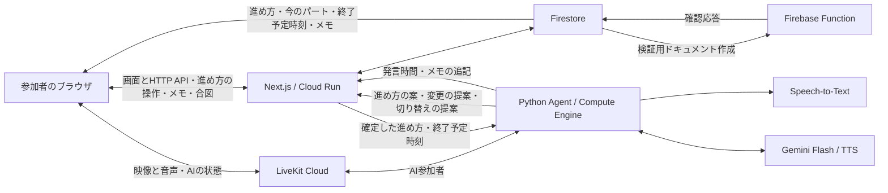

# 技術選定

2026年11月8日改訂。18歳以上向けの、AIメンバーが進行する話し合いの部屋として、Next.js、Firebase、Gemini on Vertex AIを中核にする。通話はLiveKit Cloud、常駐AIワーカーはCompute Engineに分離する。AIメンバーは参加者ごとの文字起こしで会話を追い、Geminiで進め方の案・メモ・話す内容を作り、TTSの声で話す。11月9日改訂：AIメンバーが声を出すのは、参加者が「AIに話す」を押して話しかけたときと、手を挙げて「どうぞ」を押されたときだけにした。AIメンバーは文字起こしを文脈に、必要なら道具（検索など）を使って答えるエージェントとして作る。Gemini Liveは使わない。

11月6日版は「AI先生の授業」を前提に、講義音声の事前生成を中心にしていた。プロダクトの方向を変えたため（[アプリ要件](app-requirements.md)）、講義に関わる部分を外し、発言の検出・文字起こし・Geminiによる判断を加えた。通話・認証・状態管理・実行基盤の選定は変えていない。

11月7日に、文字起こしを使わない初版を先に作る計画をやめ、最初から文字起こしとGeminiを中核にすることにした。AIが会話を聞いて考えることがプロダクトの価値そのものであり、締切までに段階を分けて検証する時間もないため。代わりに、一番危ない経路を最初に通し、うまく動かないときの逃げ道を製品の中に持つ（後述の「逃げ道」）。

開発基盤では、東京に限定公開したNext.jsからFirestoreに書き、Firestoreの作成イベントで第2世代Functionが応答を返す往復を検証した。公式エミュレータでも同じ処理を試せる。既存SQL Connectには独立した実DB疎通試験がある。部屋・通話・AIの実装と、実際の会議での性能・料金検証は次の段階で行う。[配布と検証の手順](deployment.md#firestoreとfunctionsの配布と確認)

**守るプロダクト要件**

- 2人の少人数から使え、人数が多いときは主催者がグループに分けられる。
- 進め方は最初から決めず、画面に「進め方はどうしますか？」と表示し、参加者と話し合って決める。
- AIメンバーは参加者と同じタイルに座り、会話を常に聞く。声を出すのは「AIに話す」への返答と、手を挙げて「どうぞ」を押された後だけ。
- 参加者の映像・音声とAIメンバーの声は、同じ部屋の全員に届く。
- AIメンバーが会話からパートごとのメモを書く。
- 「AIに話す」で話しかけた人が考えるための間を置いても、話し終えるまで返答を始めない。
- 個人の発言時間は本人だけに見せ、主催者にはグループ全体の偏りだけを見せる。
- AIメンバーの見た目と声はプリセットから選び、部屋で共通にする。

**採用する技術**

| 担当 | 採用技術 | 責務 |
|---|---|---|
| 画面・通常API | Next.js、React、TypeScript | 部屋、入室、進行メモ、合図、グループ分けのUIとHTTP API。進め方・今のパート・終了予定時刻を確定する |
| Web実行基盤 | Cloud Run | Next.jsをコンテナで実行。独自の音声WebSocket中継は持たない |
| 認証 | Firebase Authentication | Googleログイン。登録・参加条件は18歳以上 |
| 状態・権限 | Cloud Firestore | メンバー、招待コード、進め方（パートの並びと版番号）、今のパートと終了予定時刻、パートごとのメモ、グループ構成、合図。部屋が終わった後のノート |
| 非同期処理 | Firebase Functions 第2世代 | Firestoreのイベントに反応する。現在の実装は基盤の疎通確認 |
| 音声・映像通信 | LiveKit Cloud | 参加者の映像・音声とAIメンバーの声を同じ部屋で配信。グループごとに部屋を分ける |
| AIワーカー | Python、LiveKit Agents、Compute Engine | 各部屋で発言を検出し、文字起こしを集め、Geminiで判断し、挙手・発話・中断を行う。「AIに話す」を受けて答え、必要なら道具を呼ぶ。進め方の案と変更をWebへ提案し、メモを追記する |
| 発言の検出 | LiveKit AgentsのVAD | 参加者ごとに話しているかを判定し、発言時間と話の切れ目を求める |
| 文字起こし | Cloud Speech-to-Text（LiveKit Agentsのプラグイン経由） | 参加者ごとの音声を文字にする。日本語の精度・遅延・料金は未検証で、最初に確かめる |
| 判断と文章 | Gemini 3.8 Flash、Vertex AI経由 | 進め方の案、パートごとのメモ、脱線の判断、発話の文面、「AIに話す」への返答と道具の呼び出し。短い返答は3.5 Flash-Liteも比較中（後述の計測結果） |
| AIメンバーの声 | Gemini 3.8 Flash TTS、Vertex AI経由 | AIメンバーの発話をすべて音声にする |
| 見た目 | React、2Dのキャラクター（SVG・CSS） | AIメンバーのタイル、うなずき、挙手、口の動き、字幕 |
| 認証情報 | サービスアカウント、Secret Manager | Googleへのサーバー認証とLiveKitの秘密情報 |
| 配布 | GitHub Actions、Artifact Registry | Web・ワーカーのコンテナをビルドして各実行先へ配布 |

調べものの出典は、部屋の画面から公開資料へのリンクとして開く。Cloud Storageは参加者が資料ファイルをアップロードする機能を加える段階で、部屋単位のアクセス制御と合わせて導入する。

Next.jsが通常のHTTP APIを受ける。Webは専用サービスアカウントでCloud Runへ手動配布し、旧ページは従来のHosting専用ワークフローで公開する。

モデルIDは `gemini-3.8-flash`、`gemini-3.8-flash-tts` を初回検証の採用候補として固定する。`gemini-3.8-live` は使わず、呼びかけへの返答の遅れが実際に問題になったときに再検討する。各モデルの利用地域・割当・プロジェクトでの利用可否は初回接続で確認する。LiveKitのGoogleプラグインからVertexへ直接接続し、LiveKit経由の推論課金を選ぶ構成とは区別する。Speech-to-Textのモデルは、初回接続で日本語の精度と遅延を比べて決める。[モデル一覧とライフサイクル](https://docs.cloud.google.com/gemini-enterprise-agent-platform/models/model-versions)、[LiveKitのVertex連携](https://docs.livekit.io/agents/models/realtime/gemini/)

新しいWebとFunctionのDBはFirestore。部屋画面は対象の部屋の確定状態を購読する。入室判定や進行更新はCloud RunのNext.jsにまとめ、イベントで起動する処理はFunctionsとして別に配布する。現段階の確認経路は「Next.jsが一時ドキュメントを作成 → Functionが応答を追記 → Next.jsが一致を確認し削除」。SQL Connectの既存コネクタ、クラウド資源、独立した実DB試験は維持する。

**通信と進行の流れ**

図のWebからワーカーへの矢印は、確定した進行状態の流れを表す。ワーカーは起動・再接続時にWeb内部APIから状態を取得する。明示依頼では「AIに話す」の押下から発話に並行して読み始め、生成に使う進行案と版を固定する。

1. 主催者が部屋を作ると、Next.jsがFirestoreに部屋を作り、AIワーカーをLiveKitの部屋へ参加させる。
2. 参加者は、同意と参加条件の確認を通過すると、Next.jsが発行する短期トークンでLiveKitの部屋に入る。
3. AIワーカーは参加者ごとの音声で話しているかを判定し、発言時間と話の切れ目を求める。ここではGeminiを使わない。
4. 参加者ごとのトラックから発話区間を検出し、語頭・語尾の短い余白を含めてSpeech-to-Textへ送る。部屋のワーカーは、誰のいつの発言かを付けて確定文をメモリに保持する。
5. 進め方を決める間は、お題・合計時間・直前の会話と現在の案をGeminiに渡し、パートの追加や分数の変更をWebに提案する。部屋ごとに提案を順番に処理し、参加者の明示依頼を優先する。自動提案は新しい発言をまとめて扱う。
6. 時間、沈黙、発言の偏りはルールで判定する。脱線の判断、パートごとのメモ、発話の文面だけにGemini Flashを使う。毎回Geminiに聞くと費用と遅れが増えるため。
7. AIワーカーが自分から話したいときは、まず「手を挙げている」状態を全員に送る。参加者が「どうぞ」を押したら、TTSの音声をLiveKitへ流し、字幕も送る。話している途中で人が話し始めたら、ワーカーがその場で発話を止める。
8. Webサーバーだけが、進め方・今のパート・終了予定時刻をFirestoreに書く。ブラウザは確定した終了予定時刻から残り時間を表示し、途中参加・再接続時にも最新の進行状態を読む。端末の時計はずれることがあるので、入室時などのAPI応答でWebサーバーの現在時刻を返し、ブラウザはその差を補正して残り時間を出す。補正しないと、人によって残り時間の表示がずれる。
9. 参加者が「AIに話す」を押すと、ブラウザからワーカーへ伝わる。ワーカーはその参加者の音声だけで話し終えたかを判断し（後述の「話しかけ」）、発言の全文・直前の会話・進行状態をGemini Flashに渡して返答を作り、TTSで読み上げる。答えを作っている間は、タイルを「考えています」にする。返答に調べものが要るときは、Geminiが道具を呼ぶ（後述の「エージェントとしてのAIメンバー」）。

調査の入口は「AIに話す」と、議論マップの未確認カードの「AIに調べてもらう」。本番への導入時には、Webサーバーが部屋の参加資格と質問の状態を確認し、同じ部屋の同じ確認事項に対する依頼を一件にまとめる。カードからは音声不要で対象を特定でき、声で同じ対象を指したときもその項目を使う。

ワーカーは音声の受け渡しを続けながら、公開資料から依頼に関係するデータと出典を取得する（要件の「その次」）。取得先には調べる項目や対象年などの検索条件だけを送る。Geminiには取得した内容を渡し、画面のリンクには取得元の公開URLを使う。Webサーバーを通じて、回答の各事実と対応する出典を元の確認事項と部屋の参考資料に共有する。音声の順番を待つ間にも参加者はリンクを開ける。

調査元の候補は、統計ならe-Statのように発行元が直接提供する公開API。回答と出典を部屋の複数人に表示でき、終了後も入室者が読み返せる条件の提供元を選ぶ。Vertex AIの「Grounding with Google Search」では、標準規約が検索に基づく回答の表示先を質問を送った本人に限っている。[e-Stat API仕様](https://www.e-stat.go.jp/api/api-info/e-stat-manual)、[Google Cloudサービス固有規約 20(k)(i)(1)](https://cloud.google.com/terms/service-terms)

**進行状態の確定**

進め方の確定・変更、延長、次のパートへの切り替え、部屋の終了は、すべてWebサーバーが確定する。進行案の編集とAIからの提案には、対象の部屋と判断に使った `planVersion` を添える。進行メモの `version` は画面の再取得用で、メモ追記や承認待ち提案の表示でも進む。この2つの変更では `planVersion` を維持する。

現在のCloud RunはIAMで限定公開している。将来、参加者向けのWebを公開する段階では、ワーカーからの提案をWebサーバーで認証する。Compute Engineの実行用サービスアカウントが発行を受けたGoogle IDトークンの署名、宛先（audience）、アカウントのメールアドレスを検証する。この方式なら長期の共有鍵を増やさずに済む。

IDトークンで分かるのは「自分たちのワーカーかどうか」までで、どの部屋を担当しているかは分からない。提出範囲では、ワーカーであることの確認と版番号の照合で足りるとする。部屋ごとの担当まで確かめる必要が出たら、ワーカーを割り当てたときに記録を残して照合する。

参加者からの依頼は、Firebase Authenticationの利用者がその部屋の参加者であることをWebサーバーが確認する。部屋の終了とグループ分けは、主催者であることも確認する。

WebはFirestoreのトランザクション内で進行案の版、操作時点のサーバー時刻、固定の振り返り2分を含む合計時間を検証する。確定後の手動編集とAIの提案・承認は同じdomainルールを通す。終了済みパートは固定し、現在パートは開始時刻と位置を保ち、短縮後も終了は現在時刻より後にする。挿入位置は現在パートより後に限る。予定を更新するときは `planVersion` と画面の `version` を同時に進める。時間切れによる切り替えには、Webの時計が終了予定時刻に達していることも求める。

参加者が同じ版から同時に確定・編集した場合は先に成立した変更を残し、後から届いた操作には最新の進め方と時刻を返す。延長前の版の提案は失効する。AIの同一呼び出しの再送には記録済みの結果を返し、承認の再送でも更新は一度だけとする。予定時刻より早く届いた切り替え依頼には現在の状態を返し、ワーカーは終了予定時刻に達してから再度切り替えを求める。

AIワーカーの自動提案も音声で頼んだ変更も、Webがトランザクション内で現在時刻と予定の版を確認する。有効な変更は準備中なら即時適用し、手動確定後または準備開始から3分経過後なら参加者の承認を待つ。自動提案は有効な明示依頼を上書きせず、同じ版で見送った対象パートを避ける。口頭で説明する場合は挙手して「どうぞ」を待つ。

時間切れによる切り替えは、誰が提案しても結果が変わらない。Webサーバーが自分の時計と版番号で確かめるからである。そこで、時間切れの提案は、ワーカーだけでなく参加者のブラウザからも受け付ける。こうすると、AIワーカーが止まっていても、終了予定時刻を過ぎればパートが進む。ブラウザは、終了予定時刻を過ぎて数秒待ってもパートが変わらないときだけ提案を送る。全員が一斉に送らないよう、送る時刻は少しずつずらす。ワーカーやほかのブラウザの提案と重なっても、版番号の照合でパートが進むのは1回だけ。

次へ進めた直後と、進め方を変更した直後の数秒は、取り消しを受け付ける。取り消しも版番号付きの依頼として扱う。取り消せる時間と範囲はアプリ要件で決める。

**メモ**

パートごとのメモは、AIワーカーも参加者も項目を追記するだけにし、書かれた項目は書き換えない。追記だけなら、複数の書き手が同時に書いても競合しない。参加者とAIワーカーからの追記はNext.jsのAPIで受け、認証と部屋の確認後に保存する。メモの項目には発言者を持たせない。

部屋が終わったら、進め方とメモをそのまま残し、ノートとして読み取り専用で表示する。調査を加えるPR3では、共有した回答の要旨・適用条件・出典も同じノートに含める。Webは部屋の入室履歴で閲覧を制限し、クライアントからの直接取得にもFirestore Rulesで同じ閲覧範囲を守る。文字起こしは終了時に破棄し、発言時間と振り返りの回答は本人だけが読める場所に置く。参考資料にもノートと共通の保存期間・削除方法を適用する。具体的な期間と方法は未決定。

**招待コード**

招待コードは、Webサーバーがランダムな英数字6文字で作る。乱数には暗号用の乱数を使い、既存のコードと重ならないことをFirestoreのトランザクションで確かめる。招待リンク（`/r/[code]`）とホームのコード入力は、同じ確認の処理を通す。コードを知っていても、入室にはログイン・年齢条件・同意の確認が要る。コードを総当たりで試されないよう、利用者ごとに入力できる回数を制限する。

**入退室と参加履歴**

Firestoreの `rooms/{roomId}` に主催者のUID（`ownerUid`）と部屋の状態を持たせる。招待、年齢条件、文字起こしへの同意を確認した初回入室時に、Webサーバーが検証済みのUIDを使って `rooms/{roomId}/members/{uid}` に参加記録を作る。

参加記録には初回の入室日時（`firstJoinedAt`）、直近の入室日時（`lastJoinedAt`）、直近の退室日時（`lastLeftAt`、初回入室時は `null`）をサーバー時刻で記録する。明示的な入室状態を `joined` に保存し、状態が変わるたびに `version` を増やす。遅れて届いた操作は版番号で判別し、再入室では同じ文書を更新する。退出後にも文書が残るので、部屋の終了後にノートを開くときに参加実績を確かめられる。主催者の退室でも、ほかの人は同じ部屋を使い続けられる。

作成または入室した部屋をホームで開き直せるよう、同じトランザクションで `users/{uid}/rooms/{roomId}` にお題・コード・更新日時を保存する。「最近の部屋」には本人の直近30件を表示する。

実際に通話につながっている人の一覧は、通話を接続した段階でLiveKitの参加状態を使う。タブを閉じたり回線が切れたりすると、アプリの退室ボタンを経由しないためである。[LiveKitの入退室イベント](https://docs.livekit.io/intro/basics/rooms-participants-tracks/webhooks-events/)

**話しかけ（AIに話す）**

11月9日に、AIメンバーへの話しかけを「AIに話す」ボタンを主にした。声だけで発言の終わりを判断すると、考えるための間で区切ってしまう。11月8日にテストページ（Agentの `live-check`）で実際のマイクを使い、1人で話しても途中で返答が始まった。グループでは相づちや話の重なりが加わり、さらに難しい。名前の検出には、似た音の聞き違いと、名前を聞き取るまでの遅れも加わる。

「AIに話す」の依頼区間は、合図を送った本人のトラックで決める。合図の到着をまたぐ発話は語頭まで遡り、通常会話と同じ文字起こしを使う。話し終えたかは `live-check` の方式を使う。確定した文をつなげ、最後の声まで確定していて、文の終わり方に応じた時間（「？」「。」なら0.8秒、「、」や接続助詞なら2.5秒、その他1.5秒）だけ無音が続いたら終わりとする。押した人がもう一度押せばすぐに終える。他の人の発話も文脈に含める。

ボタンを押したことは、LiveKitのデータメッセージ（またはRPC）でワーカーへ直接送る。途中参加者が後から読む必要のない一時的な操作なので、Firestoreには書かない。誰が話しかけているかは、AIの状態と同じく全員の画面に出す。二人がほぼ同時に押したときの順番は、アプリ要件で決める。

名前で質問を受け取る機能は「その次」に残す。そのときも、ワーカーが音声を返すのは挙手に「どうぞ」が返ってからとする。足すときも、名前を検出した時点でGemini Liveにつなぐ方式は採らない。「〇〇、さっきの二案の違いは？」のように名前と質問を一息で言われると、つなぐ前に話された質問の部分がLiveに届かないためである。名前は普段の会話に出てこない音にし、文字起こしの聞き取りヒントに入れる。11月8日に、ヒントがないと「ノト」が「のと」と書き起こされた。

**エージェントとしてのAIメンバー**

AIメンバーは、決まった文を返すだけでなく、会話を踏まえて道具を使い分けるエージェントとして作る。返答を作るときは、直前の文字起こし（話者付き）・お題・進め方・今のパート・メモをGeminiに渡す。調べものが要るときは、GeminiのFunction Callingで道具を呼び、ワーカーが実行して結果をGeminiに返す。道具は最初は少数にし、統計APIや検索など、出典のURLを部屋で共有してよいものに限る（上記の調査元の条件）。

調査中はタイルに「調べています」と表示し、参加者は話し合いを続ける。1依頼内のツール呼び出しは調査期限内に終わる回数に抑え、提供元のリクエスト制限を守る。Webが調査ID・状態・期限を持ち、ワーカーが止まってもサーバーの時計で時間切れを判定する。結果は先に画面へ共有し、AIは挙手して「どうぞ」を待ってから要点を話す。

最初の道具は `propose_agenda(operations, reason)` とする。ワーカーが生成時の別名を固定のパートIDへ戻し、進行案の版と呼び出しIDを付ける。Webは変更操作の列を一括で検証し、適用・承認待ち・失効・無効の結果を返す。明示依頼への応答は結果ごとの定型文を使う。実装順はPR0（固定ID）、PR1（常時文字起こし）、PR1.5（版の分離と確定後の手動編集）、PR2（提案と承認）、自動提案とパートメモ、PR3（調査）。[会議エージェントの実装設計と合格条件](meeting-agent-design.md)

**AIの状態と遅れ**

聞いている・手を挙げている・考えている・話しているといったAIの状態は、LiveKitの参加者属性かデータメッセージで送る。遅れが小さく、部屋を出れば消える一時的な状態だからである。進め方やメモなど、途中参加者が後から読む必要のあるものはFirestoreに置く。どちらの方式を使うかは初回実装で確かめる。

文字起こしの確定、Geminiの判断、TTSの音声生成と順に待つので、AIが話し始めるまでに数秒かかる可能性がある。先に手を挙げた表示を出し、待ち時間を「話す順番を待っている」ように見せる。ただし、遅れて前の話題に反応すると不自然になる。実際の遅れは未計測で、許容できる範囲は最初の接続で測って決める。

グループに分けるときは、グループごとに別のLiveKitの部屋を作り、それぞれにAIワーカーのジョブを割り当てる。参加者を移すときは、サーバーが移動先の部屋のトークンを発行し、ブラウザが入り直す。1台のCompute Engineで同時に何部屋を動かせるかは未検証。

**逃げ道**

別の版を作らず、製品の中に逃げ道を持つ。

| うまく動かないもの | 逃げ道 |
|---|---|
| Geminiが進め方の案を作れない | 決まった型の進め方を案として出す |
| 文字起こしの精度が低い・遅い | 進め方とメモは画面から直せる。「AIに話す」の終わりが判断されないときは、もう一度押して終える |
| AIワーカーが止まった | 会話・残り時間の表示・パートの進行は続く。時間切れの切り替えはブラウザからも依頼できる |
| TTSが遅い・失敗する | 字幕だけを出す |

**声とアバター**

AIメンバーのプリセットに `avatarId`、`displayName`、`ttsVoiceName` を持たせる。AIの声はTTSの一種類だけにする。Liveを使わない理由の一つで、TTSとLiveで声の聞こえ方が変わる問題を避けられる。声は日本語の試聴結果で決める。プリセットは部屋で共通にし、参加者ごとに変えない。

AIメンバーの声はVertex経由の `gemini-3.8-flash-tts` を使う。11月8日に `gemini-3.8-flash-lite-tts` と同じ返答で聞き比べ、声の自然さからこちらに決めた。最初の音までの差は0.1〜0.2秒だった。Cloud Text-to-Speechの別APIと混同しない。APIが異なれば、同じモデルIDをそのまま使えるとは限らない。[Gemini 3.8 Flash TTS](https://docs.cloud.google.com/gemini-enterprise-agent-platform/models/gemini/3-8-flash-tts)、[TTS概要](https://docs.cloud.google.com/gemini-enterprise-agent-platform/models/text-to-speech/overview)

アバターは映像を作らず、ブラウザで2Dのキャラクターとして描く。AIワーカーは映像トラックを送らない。口はブラウザがAIの音声トラックの音量から動かし、うなずきや挙手はAIの状態から切り替える。写実的な映像アバターを生成する外部サービスもあるが、費用と遅れが大きく、人間と見分けにくい。ひと目でAIだと分かる見た目のほうが、このプロダクトには合う。

**資料から修正する点**

| 提示された選定書の案 | 最終判断 |
|---|---|
| 事前生成した講義音声、Q&AだけLive | 11月7日に変更。講義がなくなったため事前生成は使わない。呼びかけへの応答も文字起こし経由にし、Liveは使わない |
| WebRTC P2P、Firestoreによる接続仲介、STUNのみ | 不採用。少人数でもTURNが必要なネットワークがある。通信処理を自作しない |
| Cloud RunでAI音声を全員へ中継 | 不採用。部屋ごとの接続一覧、配信、切断復旧を抱えない |
| 最大1インスタンスで同じ部屋を維持 | 正しさの前提にしない。再起動やデプロイ時の復旧が必要 |
| 教室では生徒同士を接続しない | 修正。参加者同士の映像と音声を共有する |
| 生徒のアバターだけを選択 | 修正。AIメンバーの見た目と声を選べるようにする |
| 部屋のメンバー全員が状態を読み書き | 修正。進め方・今のパート・終了予定時刻・グループ構成はWebサーバーが確定する。参加者もAIワーカーも変更は依頼するだけ。メモは追記だけにする |

P2Pは不可能なのではなく、今回の締切と複数人の映像・音声要件に対して自作する負担が大きい。接続情報をDBで共有しても、通信の中継に必要なTURNは別途用意する。Cloud RunはWebSocketを扱えるが、最大台数の設定は永続的な一つのプロセスを保証しない。[WebRTC公式](https://webrtc.org/getting-started/turn-server)、[Cloud RunのWebSocket](https://docs.cloud.google.com/run/docs/triggering/websockets)、[最大インスタンス数](https://docs.cloud.google.com/run/docs/configuring/max-instances)

**権限と費用**

入室トークンは、バックエンドがログイン・年齢条件・招待・同意を確認してから発行する。招待URLを知るだけでは主催者の権限は得られない。部屋の終了とグループ分けは、主催者であることをサーバーで確認する。参加者は進め方の操作、延長、次のパートへの切り替え、メモの追記など、許可された操作だけを依頼でき、Firestoreの進行状態を直接書き換えられない。Admin SDKを使うサーバー側でも権限を確認する。

合図はNext.jsのAPIで受け、送り主はサーバー側だけで扱う。連打を防ぐため、利用者ごとに送れる回数を制限する。本人だけが読む発言時間と振り返りは共用の部屋ドキュメントから分け、Firestore Rulesで部屋所属と本人のUIDを照合する。主催者に見せる集計にはグループ全体の偏りの度合いだけを含める。現在のRulesは基盤用で、クライアントからのアクセスは閉じている。

Vertexにも年齢制限があることは確認済みであり、未確認とは記載しない。対象・募集・登録・入室を18歳以上にそろえる。「18歳以上」と表示するだけで適合を保証しない。[Cloud規約20(d)](https://cloud.google.com/terms/service-terms)

配布クレジット額は20ドル。Google Cloud、LiveKit、文字起こし、保存・転送の費用は実測の参考値として扱う。文字起こしと「AIに話す」は同意して入室した参加者が会議中に利用できる。空室・終了時にはAIセッションと音声購読を閉じる。

**提出範囲と合格条件**

最初は1部屋、最大4人とAIメンバー、AIメンバーのプリセットは少数に限定する。写実的な映像アバター、資料のアップロード、成績・評価、録画は含めない。必須・その次・削る候補の区分は[アプリ要件](app-requirements.md#提出範囲)に従う。

最初に、声 → 文字起こし → Gemini → TTSの声と字幕までを一本つなぎ、AIが話し始めるまでの遅れ、日本語の聞き取り精度、1分あたりの費用を測る。画面を作り込む前にこれを行うのは、問題が締切の直前に見つかるのを避けるため。

初回の測定用に、1人とAIの一発話専用の検証室を実装した。Silero VADで区切った音声をGoogle STTプラグインへ送り、GeminiとTTSは利用トークン数を取得するためGoogle Gen AI SDKからVertexへ直接接続する。試行ごとの測定条件と起動方法は[音声テスト](voice-probe.md)に記す。

この計測にはAgentの `voice-check` を使う（[手順](../apps/agent/README.md#声の計測voice-check)）。LiveKitを通さず、録音を実時間の速さで送る。11月8日に公式資料で確かめた、計測前に分かっていること:

- Speech-to-Textの `chirp_3` は日本語のストリーミングに対応するが、提供場所は `us`・`eu` だけで、東京にはない。日本からの往復の遅れが文字起こしの待ちに加わる。
- Gemini 3.8 Flashの思考の量は `low`・`medium`・`high` から選ぶ。`minimal` は使えない。遅れを抑えるため `low` で測る。
- Gemini TTSのストリーミングは、24kHz・モノラル・16ビットのPCMを少しずつ返す。最初の音までの時間は `global` より `us`・`eu` のほうが短いとされる。`gemini-3.8-flash-lite-tts` は遅れと費用を抑える用途向けで、表現力を優先するなら `gemini-3.8-flash-tts` とされる。遅れが問題なら両方を測って比べる。
- 表示価格は、Speech-to-Textが1分0.016ドル（1秒単位）、Gemini 3.8 Flashが100万トークンあたり入力0.75ドル・出力3.75ドル（思考を含む）、Gemini 3.5 Flash-Liteが入力0.30ドル・出力2.50ドル、Gemini 3.8 Flash TTSが入力0.50ドル・音声出力9.00ドル、Flash-Lite TTSが音声出力6.00ドル。Gemini 3.8 FlashとTTSは12月31日までの導入価格で、1月1日から2倍になる。[Speech-to-Textの料金](https://cloud.google.com/speech-to-text/pricing)、[Vertex AIの料金](https://cloud.google.com/vertex-ai/generative-ai/pricing)、[Chirp 3](https://docs.cloud.google.com/speech-to-text/docs/models/chirp-3)、[Gemini TTS](https://docs.cloud.google.com/gemini-enterprise-agent-platform/models/text-to-speech/overview)

**11月8日の計測結果**

`hackathon-7314b` で、自宅の回線から `voice-check` を実行した。入力はmacOSの読み上げ（Kyoko）で作った約4秒の日本語の質問で、人の声ではない。聞き取りの誤り率はどの回も0%だったが、合成音声は聞き取りやすいため、精度の判断には使わない。人の声での精度は未計測。

| 組み合わせ | AIが話し始めるまで（4回） | 内訳の目安 |
|---|---|---|
| 既定：`chirp_3`（区切り standard）、Gemini 3.8 Flash（思考 low）、Flash TTS | 失敗（30秒で打ち切り）・17.2秒・7.9秒・5.1秒 | 文字起こし約2.0秒、Gemini 1.7〜13.5秒、TTS 1.0〜1.3秒 |
| 速さ優先：`chirp_3`（区切り short）、Gemini 3.5 Flash-Lite（思考の指定なし）、Flash-Lite TTS | 4.3秒・3.9秒・3.2秒・3.5秒（中央値3.7秒） | 文字起こし約1.6秒、Gemini 0.6〜1.2秒、TTS 0.9〜1.1秒 |

- 遅れの大部分はGemini 3.8 Flashだった。思考を `low` にしても、回によって200〜550トークン考え、最初の文字まで1〜18秒、一度は134秒かかった。`thinking_budget=0` は無視された。3.8 Flashは東京（`asia-northeast1`）では404で使えず、`us` でも同じ傾向だった。Gemini 3.5 Flash-Liteは思考せず、別に測った単独の呼び出しでも、接続済みなら0.5〜0.9秒で安定していた。返答の質は、どちらも問いを返す短い文になった。Flash-Liteは一度、文の後ろにHTMLのタグを付けたため、読み上げ前に記号とタグを取り除くようにした。
- `chirp_3` は途中経過を返さず、話し終えてから確定まで約2.0秒（区切り standard）、約1.5秒（short・supershort）。早めに送信を閉じても0.2秒ほどしか縮まらなかった。比較として東京の `long` モデルを測ると、確定まで約1.3秒で、途中経過も返した。日本語の精度で比べてから選ぶ。
- TTSの最初の音は、接続済みなら0.5〜0.7秒、初回は1.2〜1.35秒。Flash-Lite TTSのほうが0.1〜0.2秒速い。話す速さを「急がず」と指示すると、58文字の返答が12秒になったため、「自然な速さで」に改めた。
- 1回の費用は0.3セント前後で、1分あたりの見込みは約0.05ドル（3人の文字起こしが0.048ドル、AIが1分に1回話す分が0.1〜0.4セント）。費用の大半は文字起こしで、人数と時間に比例する。

これらから、話しかけへの短い返答に3.8 Flashを使うと、AIが話し始めるまでの時間が回ごとに大きくぶれ、30秒を超えることもある。短い返答は3.5 Flash-Liteに任せ、時間に余裕のある進め方の案やメモにだけ3.8 Flashを使う案がある。どちらを採るかは未決定。部屋の実装では、Geminiの呼び出しに時間の上限を設け、超えたら挙手を下ろすなどの逃げ道を持つ。

同じ日に、ブラウザのテストページ（Agentの `live-check`）でも測った。組み込みブラウザからサンプル音声を流し、文字起こし `chirp_3`（区切り short）、Gemini 3.5 Flash-Lite、Flash TTSの組み合わせで、ブラウザで声が途切れてから声が鳴るまでが1回目6.9秒（接続の準備を含む）、2回目3.5秒、3回目3.6秒だった。内訳は、確定まで約1.5秒、字幕まで2.4〜2.6秒。前の発言を踏まえた返答になったが、Flash-Liteの返答に「未分野」のような不自然な語が混ざることがあり、問いではなく提案で終わる回もあった。聞き取りヒントにAIメンバーの名前を入れないと「ノト」が「のと」と書き起こされた。

**話し終えたかの判断**

利用者が実際のマイクで話すと、話している途中でAIが返答を始めた。原因は、文字起こしの最初の確定を「話し終えた」と扱っていたこと。`chirp_3` の確定は話の切れ目を表すだけで、区切りを short にすると1秒前後の間でも確定する。人は考えるために間を置くため、確定だけでは発言の終わりを判断できない。

そこで、確定した文をつなげて聞き続け、「最後に聞こえた声まで確定している」かつ「最後の声から、文の終わり方に応じた時間だけ無音が続いた」ときに話し終えたと判断する方式にした。待つ時間は、「？」「。」で終わる文は0.8秒、「、」・接続助詞・格助詞・「えーと」などで終わる文は2.5秒、どちらとも言えない文は1.5秒。終わり方の手がかりには、文字起こしが付ける句読点と語尾を使う。この値は仮説で、人の声で試して調整する。調整用に、待つ時間を全体に伸ばす倍率を `live-check` に付けた。

利用者は「前よりは良くなったが、声だけでは限界がある」と評価した。これを受けて11月9日に、AIが声を出す場面を「AIに話す」への返答と「どうぞ」の後に限った（[アプリ要件](app-requirements.md#聞くことと話すこと)、上記の「話しかけ」）。この判断は、グループの会話全体ではなく、「AIに話す」を押した1人の声にだけ使う。判断の誤りに対する最後の守りは、AIが話している途中で人が話し始めたら止めること（要件の4番）で、テストページにはまだない。LiveKit Agentsには、言葉の内容から発言の終わりを予測する仕組みがある。部屋の実装に移るとき、この方式と比べて選ぶ。

別回線の2〜3端末で、映像と音声の共有、進め方をAIと決めること、パートの進行、AIのメモ、「AIに話す」で話しかけて考えるための間を置いても途中で返答されないこと、AIメンバーが「AIに話す」と「どうぞ」以外で話し始めないこと、人が話し始めたらAIが話すのをやめること、字幕、振り返り、途中参加、切断復帰を確認する。主催者や話している人が退室しても、残りの参加者の話し合いが続くことを確認する。

他人の発言時間と振り返りの回答を、APIやデータから読めないことも検証する。偽のIDトークンや別のサービスアカウントからの提案が拒否されること、二人が同時に確定しても一方だけが反映されること、AIワーカーを止めても終了予定時刻を過ぎればパートが進むこと、端末の時計をずらしても残り時間の表示がそろうことも確かめる。

その次を足すときは、名前と質問を一息で言っても質問の全文に沿って応えること、名前に似た普段の言葉に反応しないこと、匿名の合図の送り主を読めないことを確認する。

実装順は「1人とAIで声から文字起こし・Gemini・声と字幕までをつなぎ、実サービスで遅れ・精度・費用を測る → 2人とAIの通話 → 進め方の決定と進行メモ → パートの進行（Webサーバーが確定） → AIメンバーの見せ方と話す場面（アバター・「AIに話す」・挙手と「どうぞ」・中断） → パートごとのメモと振り返り → 招待・入室・同意 → デプロイと提出用デモ」。その次の機能と削る候補は、必須が動いてから足す。画面（client）、Webサーバー、AIワーカーは分けて並行で進められる。

元資料: ユーザー提供の「AI教室 技術選定書.pdf」（原本はリポジトリに含めない。11月6日版の授業形式を前提にした資料で、方向を変えた後の判断は本文を優先する）。大会ルールの根拠: ユーザー提供の「[DF Hack26] Kickoff Slide.pdf」（配布PDFはリポジトリに含めない）。Google基盤とGeminiを中核に使う方針であり、補助的な通信サービスまでGoogle製に限定するルールとは解釈しない。
